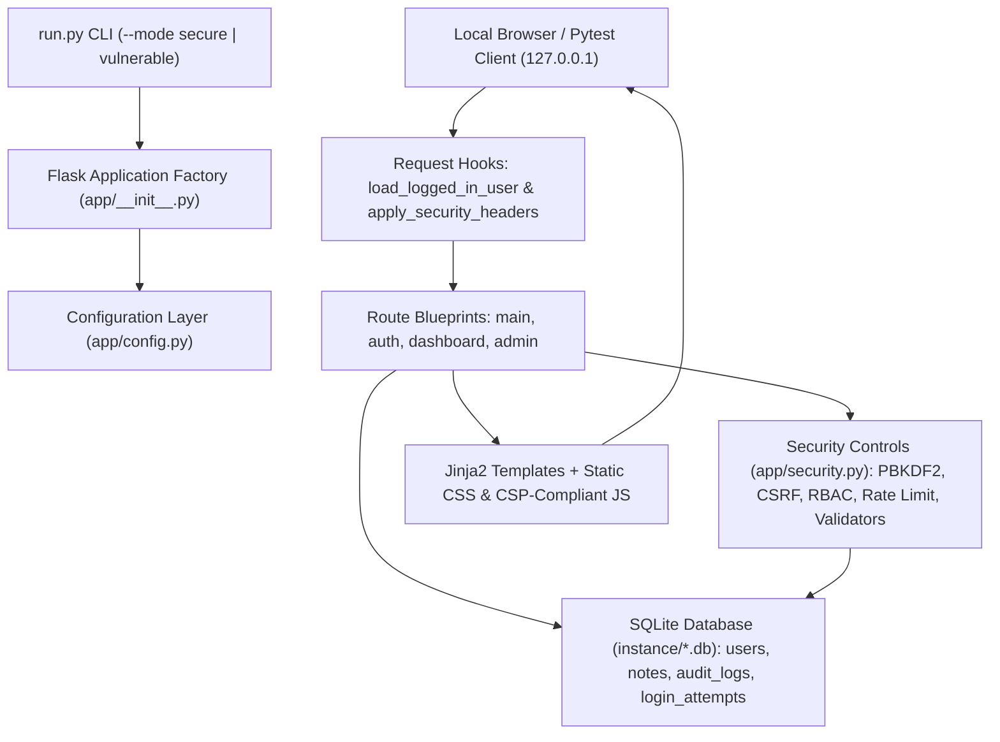
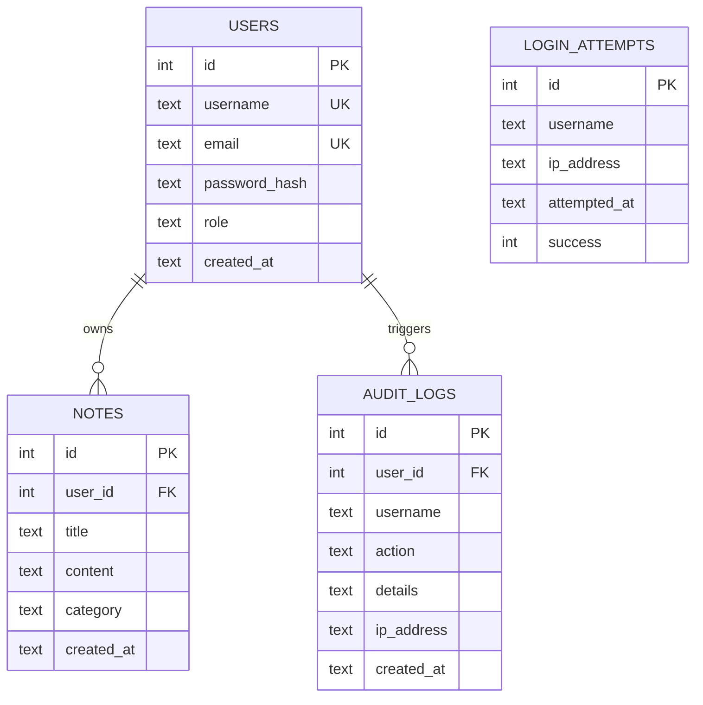

# Project Architecture — SecVault Web Application Security Lab

## 1. Architectural Overview

**SecVault** is a modular, dual-mode Flask + SQLite web application designed specifically for hands-on academic web application security assessment and remediation verification.

Instead of maintaining two disconnected codebases, SecVault uses a **Flask Application Factory (`create_app`)** controlled strictly by server startup configuration (`--mode secure` or `--mode vulnerable`, defaulting to **`secure`**). This allows learners and reviewers to inspect **side-by-side** how a specific insecure pattern behaves and how its exact security control remediates the flaw.

> **Safety Boundary:** The security mode can only be selected at server startup on `127.0.0.1` (localhost). It cannot be toggled from the web UI or by remote users.

---

## 2. High-Level System Architecture

---

## 3. Component Breakdown

### 3.1 Entry Point (`run.py`)
- Parses `--mode` (`secure` or `vulnerable`), `--host` (defaults to `127.0.0.1`), and `--port` (defaults to `5000`).
- Launches Flask with `debug=False` to prevent Werkzeug debugger/PIN exposure.

### 3.2 Configuration Layer (`app/config.py`)
- Loads optional local `.env` values without requiring third-party packages.
- Dynamically generates a 256-bit runtime `SECRET_KEY` via `secrets.token_hex(32)` if `FLASK_SECRET_KEY` is not set—ensuring **no hardcoded secrets exist in Git**.
- Configures session cookies, session lifetimes, error verbosity, and debug endpoint exposure differently between `vulnerable` and `secure` modes.

### 3.3 Database Layer (`app/db.py`)
Uses Python's built-in `sqlite3` module with foreign key enforcement (`PRAGMA foreign_keys = ON;`) and four normalized tables:

### 3.4 Security Controls Layer (`app/security.py`)
Centralizes all defensive engineering controls:
1. **Password Hashing:** `generate_password_hash(..., method="pbkdf2:sha256:600000", salt_length=16)` and constant-time `check_password_hash`.
2. **Input Validation:** Strict regex & length validation for usernames, emails, strong password rules, and note categories/sizes.
3. **CSRF Protection:** Synchronizer Token Pattern (`secrets.token_urlsafe(32)` bound to session, verified with `hmac.compare_digest` via `@csrf_protect`).
4. **Rate Limiting:** Tracks failed logins in `login_attempts` and triggers HTTP `429 Too Many Requests` after 5 failed attempts within 15 minutes.
5. **Authentication & RBAC:** `@login_required` and `@role_required("admin")` always validate the live user role directly from SQLite (`g.user`), never trusting client-supplied role parameters.
6. **HTTP Security Headers:** `apply_security_headers` sets `Content-Security-Policy`, `X-Content-Type-Options`, `X-Frame-Options`, `Referrer-Policy`, `Permissions-Policy`, `Cross-Origin-Opener-Policy`, and `Cache-Control: no-store` for authenticated pages.

### 3.5 Route Blueprints (`app/routes/`)
| Blueprint | File | Responsibilities |
| :--- | :--- | :--- |
| `main` | `app/routes/main.py` | Home overview (`/`), local lab guide (`/lab-guide`), local CSRF simulator (`/lab/csrf-demo`), misconfiguration test endpoints (`/debug/info`, `/debug/error-test`) |
| `auth` | `app/routes/auth.py` | Registration (`/register`), Login (`/login`), Logout (`/logout`) |
| `dashboard` | `app/routes/dashboard.py` | Personal dashboard & search (`/dashboard`), note CRUD (`/notes/create`, `/notes/<id>`, `/notes/<id>/delete`), profile management (`/profile`, `/profile/update`) |
| `admin` | `app/routes/admin.py` | User listing & audit log viewer (`/admin`), user role management (`/admin/users/<id>/role`) |

### 3.6 Frontend (`app/templates/` & `app/static/`)
- **Jinja2 Templates:** Auto-escape HTML by default in `secure` mode; explicitly show `| safe` anti-patterns only when `is_vulnerable` is true.
- **CSP-Compliant Static Assets:** All styling is in `static/css/style.css` and all client interactivity (password strength meter, delete confirmations, lab payload copy buttons) lives in `static/js/app.js` with **zero inline JavaScript**, enabling a strict `script-src 'self'` Content Security Policy.
